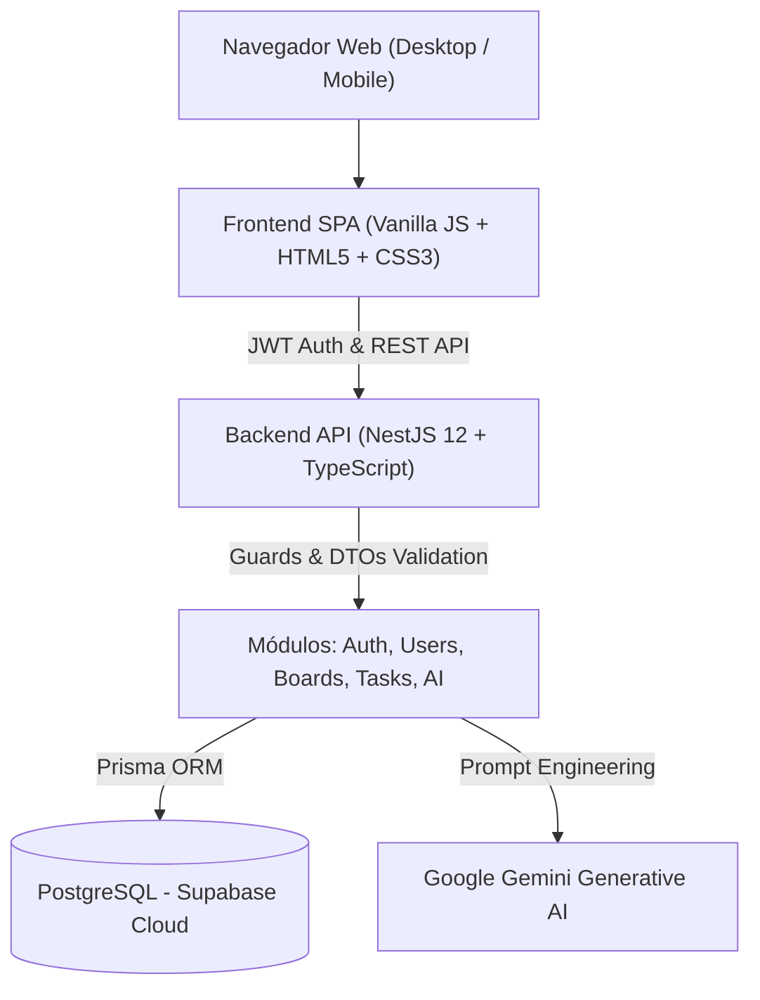
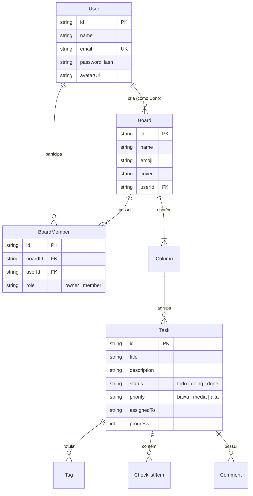

# 🚀 Task Manager — Fullstack Collaborative Kanban with AI

<div align="center">


**Plataforma Fullstack de Gestão de Tarefas e Projetos Colaborativos, inspirada no Trello e Notion, equipada com controle rigoroso de acesso multi-equipe, IA integrada (Google Gemini) e arquitetura orientada a microsserviços/módulos.**

[Visão Geral](#-visão-geral) •
[Funcionalidades](#-funcionalidades-chave) •
[Arquitetura](#-arquitetura--tecnologias) •
[Como Executar](#-como-executar-localmente) •
[Documentação da API](#-documentação-da-api)

</div>

---

## 📌 Visão Geral

O **Task Manager** é uma solução completa desenvolvida para compor portfólio de engenharia de software fullstack. Ele resolve desafios reais de gerenciamento de trabalho:
1. **Isolamento e Segurança Multi-Setor:** Cada quadro é restrito aos membros associados, impedindo vazamento de informações entre diferentes equipes.
2. **Produtividade Acelerada por IA:** Decomposição inteligente de tarefas complexas em subtarefas acionáveis, geração de descrições detalhadas e resumos executivos através do Google Gemini.
3. **Desempenho Otimizado:** Atualizações otimistas na interface, prevenção contra múltiplos cliques concorrentes (*mutex lock*) e transações aninhadas em query única no PostgreSQL com o Prisma ORM.
4. **Experiência Visual Imersiva:** Alternância dinâmica entre **Dark Mode** e **Light Mode**, personalização de cores, ícones, capas em gradientes/imagens e exportação de relatórios em PDF.

---

## ✨ Funcionalidades Chave

### 📊 Gestão de Quadros e Visualizações Múltiplas
* **Visão Kanban Interativa:** Drag-and-drop suave para movimentação de tarefas entre colunas personalizadas (*A Fazer*, *Em Andamento*, *Concluído*, etc.).
* **Visão Lista e Tabela:** Alternância instantânea de exibição para análise detalhada de prazos, prioridades e responsáveis.
* **Personalização Total:** Escolha de ícones (emojis categorizados), cores sólidas, gradientes e envio de imagens de capa personalizadas.

### 👥 Controle de Acesso e Colaboração Segura
* **Papéis e Permissões:** Separação entre proprietário (`👑 Dono`) e participantes (`Membro`).
* **Adição de Membros na Criação:** Aba dedicada no modal de novo quadro para buscar e vincular usuários cadastrados antes mesmo de salvar o quadro.
* **Gerenciamento Dinâmico Interno:** Adição e remoção de membros em tempo real diretamente pelo cabeçalho do board.
* **Isolamento de Dados no Banco:** Usuários não-membros não conseguem listar, acessar ou alterar tarefas de quadros alheios.

### 🤖 Inteligência Artificial (Google Gemini)
* **Decomposição em Checklist:** A IA analisa o título da tarefa e gera passos lógicos para sua execução.
* **Gerador de Descrição:** Criação de escopo claro e detalhado para a tarefa com 1 clique.
* **Resumo Executivo do Quadro:** Análise geral de status, gargalos e prazos da equipe em linguagem natural.

### ⚡ Engenharia de Performance & UX
* **Proteção Anti-Duplicação:** Botões de envio bloqueados com feedback visual de carregamento (*spinners*), prevenindo duplicidades em redes lentas.
* **Criação Atômica Aninhada:** Registro simultâneo de quadro, colunas padrão e membros em uma única query Prisma.
* **Sincronização Não-Bloqueante:** O estado local reflete as alterações imediatamente enquanto o backend processa em background.
* **Exportação em PDF:** Geração de relatórios organizados prontos para impressão ou compartilhamento.

---

## 🏗️ Arquitetura & Tecnologias



### Tecnologias Utilizadas:
| Camada | Ferramenta / Biblioteca | Descrição |
| :--- | :--- | :--- |
| **Backend** | **NestJS 12 + TypeScript** | Framework corporativo estruturado em módulos, controllers, services e DTOs tipados. |
| **Segurança** | **Passport + JWT + bcrypt** | Autenticação stateless com tokens JWT e hash criptográfico de senhas. |
| **Banco de Dados** | **PostgreSQL (Supabase)** | Banco relacional escalável com integridade referencial e chaves compostas. |
| **ORM** | **Prisma 6** | Modelagem de dados declarativa, migrações seguras e consultas com tipagem estática. |
| **Inteligência Artificial**| **Google Generative AI SDK** | Integração direta com a API dos modelos Gemini para NLP e automações. |
| **Frontend** | **Vanilla JS (ES6+), HTML5, CSS3** | Arquitetura modular sem dependências pesadas, garantindo carregamento ultrarrápido. |
| **Deploy & Infra** | **Render + render.yaml** | Configuração declarativa de Infraestrutura como Código (IaC). |

---

## 🗄️ Modelo de Dados (Entity-Relationship)



---

## 💻 Como Executar Localmente

### Pré-requisitos
* **Node.js** (versão 20.x ou superior)
* **npm** ou **yarn**
* Uma instância PostgreSQL (recomendado: projeto gratuito no [Supabase](https://supabase.com))
* Chave de API do Google Gemini (gratuita no [Google AI Studio](https://aistudio.google.com/))

### 1. Clonar o Repositório
```bash
git clone https://github.com/davigermanetti-tech/TaskManager.git
cd TaskManager
```

### 2. Configurar o Backend
```bash
cd backend
npm install
```

Crie o arquivo de ambiente a partir do modelo:
```bash
cp .env.example .env
```
Preencha o `.env` com suas credenciais:
```ini
PORT=3000
DATABASE_URL="sua-string-de-conexao-supabase-pooler-porta-6543"
DIRECT_URL="sua-string-de-conexao-supabase-porta-5432"
JWT_SECRET="gere-um-segredo-com-openssl-rand-hex-32"
GEMINI_API_KEY="sua-chave-api-gemini"
```

Sincronize as tabelas do banco de dados:
```bash
npx prisma db push
```

Inicie o servidor de desenvolvimento:
```bash
npm run start:dev
```
O servidor estará respondendo em: `http://localhost:3000`.

### 3. Executar o Frontend
Basta abrir o arquivo `index.html` na raiz do projeto utilizando a extensão **Live Server** do VS Code (porta 5500) ou qualquer servidor estático:
```bash
npx serve .
```
Acesse no navegador: `http://localhost:5500`.

---

## 📖 Documentação da API

Todas as rotas (exceto `/auth/*` e `/health`) exigem o envio do token no cabeçalho:
`Authorization: Bearer <seu_token_jwt>`

| Método | Endpoint | Descrição |
| :--- | :--- | :--- |
| `GET` | `/health` | Checagem de integridade do serviço (usado pelo Render). |
| `POST` | `/auth/register` | Cria uma nova conta de usuário. |
| `POST` | `/auth/login` | Autentica e retorna o JWT accessToken e perfil. |
| `GET` | `/users?search=` | Lista usuários cadastrados com busca por nome/email. |
| `GET` | `/boards` | Lista quadros que o usuário logado possui ou participa. |
| `POST` | `/boards` | Cria um novo quadro (com suporte a `memberIds`). |
| `GET` | `/boards/:id` | Retorna detalhes, colunas, tarefas e membros do quadro. |
| `PATCH`| `/boards/:id` | Atualiza nome, emoji ou capa do quadro. |
| `DELETE`| `/boards/:id` | Exclui o quadro (permitido apenas para o proprietário). |
| `GET` | `/boards/:id/members` | Lista participantes ativos do quadro. |
| `POST`| `/boards/:id/members` | Adiciona um usuário cadastrado como membro. |
| `DELETE`| `/boards/:id/members/:userId` | Remove um membro do quadro. |
| `POST` | `/tasks` | Cria uma nova tarefa. |
| `PATCH`| `/tasks/:id` | Atualiza dados, status, progresso ou checklist da tarefa. |
| `DELETE`| `/tasks/:id` | Remove uma tarefa. |
| `POST` | `/ai/subtasks` | Gera checklist inteligente via IA para a tarefa. |
| `POST` | `/ai/description` | Gera descrição detalhada para a tarefa via IA. |
| `POST` | `/ai/summary` | Gera resumo executivo do quadro via IA. |

---

## 👨‍💻 Autor

Desenvolvido por **Davi Germanetti** para demonstração de competências avançadas em desenvolvimento fullstack, engenharia de software e integração com inteligência artificial.

* GitHub: [@davigermanetti-tech](https://github.com/davigermanetti-tech)
* Repositório: [TaskManager](https://github.com/davigermanetti-tech/TaskManager)


